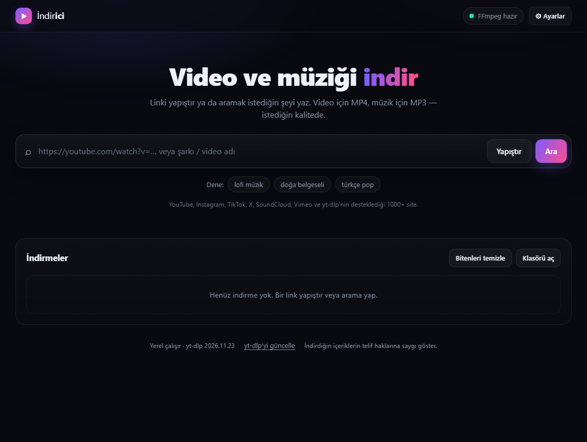

# İndirici

**Windows masaüstü + Android** için video ve müzik indirici. Linki yapıştır ya da arama yap; videoları **MP4**, müzikleri **MP3** (ve daha fazlası) olarak istediğin kalitede indir. Masaüstü sürümü tarayıcı sekmesi değil, kendi penceresinde açılan bir uygulamadır.

İndirme motoru [yt-dlp](https://github.com/yt-dlp/yt-dlp), dönüştürme için FFmpeg kullanır. Her şey kendi cihazında çalışır; hiçbir veri sunucuya gitmez.



## İndir

| Platform | Dosya | Not |
|---|---|---|
| **Windows** | `Indirici-Setup-1.2.0.exe` | Kurulum sihirbazı (yönetici gerekmez) |
| **Android** | `Indirici-1.0.0.apk` | Android 7.0 (API 24) ve üzeri |

İndirme bağlantıları deponun **Releases** bölümünde: <https://github.com/Zeki-wq/t-m-platformlardan-indirme-yapan-uygulama/releases>

- **Windows:** Setup dosyasını çalıştır → İleri → Kur. Masaüstü ve Başlat menüsüne kısayol eklenir.
- **Android:** APK'yı telefona indir → aç → “Bilinmeyen kaynaklara izin ver” → Kur.

## Özellikler

- **Link yapıştır** → video bilgileri gelir, kalite ve format seçip indirirsin.
- **Arama yaz** → sonuçlar kapak görseliyle listelenir, tek tıkla indirilir.
- **Video:** MP4, MKV, WEBM — kaynağın sunduğu tüm çözünürlükler (144p'den 4K/8K'ya).
- **Ses:** MP3, M4A, OPUS, WAV, FLAC — 128 / 192 / 256 / 320 kbps veya "en iyi".
- **Oynatma listesi:** liste linkinde "tüm listeyi indir" seçeneği.
- İndirme kuyruğu, canlı ilerleme, hız / kalan süre, iptal etme.
- **Ayarlar ekranı:** tarayıcı çerezleri veya `cookies.txt` ile giriş gerektiren siteler.
- **Android'de paylaş menüsü:** Instagram/TikTok'ta “Paylaş → İndirici” ile linki doğrudan uygulamaya gönder.
- 1000+ site: YouTube, Instagram, TikTok, X (Twitter), SoundCloud, Vimeo, Facebook, Dailymotion…

## Instagram / TikTok / Facebook çalışmıyor mu?

Bu siteler çoğu zaman **giriş (çerez)** ister. Uygulamada bunun için ayar ekranı var:

1. Uygulamayı aç → sağ üstteki **⚙ Ayarlar**.
2. **Çerezleri al — tarayıcı** listesinden giriş yaptığın tarayıcıyı seç (Chrome, Edge, Firefox…).
   - Tarayıcı açıkken çerez dosyası kilitli olabilir. **Test et** hata verirse tarayıcıyı tamamen kapatıp tekrar dene.
3. Ya da **cookies.txt dosyası** yolunu göster:
   - Chrome/Edge için **“Get cookies.txt LOCALLY”** uzantısını kur, `instagram.com` sayfasında dışa aktar, dosya yolunu yaz.
4. **Kaydet** → **Test et**. “Çerezler okundu: N adet” yazarsa hazır.

Masaüstünde `ayarlar.json` dosyasını elle de düzenleyebilirsin:

```json
{
  "cookies_from_browser": "chrome",
  "cookies_file": ""
}
```

Android'de uygulama, giriş gerektiren siteler için kendi içindeki yt-dlp'yi otomatik günceller. Yine sorun olursa alttaki **“yt-dlp'yi güncelle”** düğmesine bas.

## Windows — Python ile çalıştırma

1. Python 3.10 veya üzeri: <https://www.python.org/downloads/>
   Kurulum ekranında **“Add python.exe to PATH”** kutusunu işaretle.
2. **`baslat.bat`** dosyasına çift tıkla.

İlk çalıştırmada paketler otomatik kurulur (birkaç dakika), ardından uygulama kendi penceresinde açılır. FFmpeg ayrıca kurmana gerek yok; `imageio-ffmpeg` ile birlikte gelir.

Windows 10/11'de **WebView2** genelde hazırdır. Değilse: <https://developer.microsoft.com/microsoft-edge/webview2/>

## Windows — EXE / kurulum dosyası derleme

```bat
derle.bat
```

Bu betik sırayla:

1. `dist\Indirici\Indirici.exe` üretir (PyInstaller, birkaç dakika).
2. Inno Setup kuruluysa `kurulum\Indirici-Setup-1.2.0.exe` dosyasını oluşturur.

Sadece Inno Setup ile kurulum dosyası üretmek için:

```bat
"%LOCALAPPDATA%\Programs\Inno Setup 6\ISCC.exe" kurulum.iss
```

Kurulum **kullanıcı bazlıdır** (yönetici izni istemez), `%LOCALAPPDATA%\Programs\Indirici` klasörüne kurulur. İndirilen dosyalar `%USERPROFILE%\Downloads\Indirici` klasörüne gider.

## Android — APK derleme

Android uygulaması ayrı bir native projedir (`android/` klasöründe değil, bu depoda `apk/` altında hazır APK olarak durur; kaynak `android-app/` klasöründe).

Gerekenler: **JDK 17** ve **Android SDK** (platform 34, build-tools 34.0.0). Gradle wrapper depoda hazır.

```bat
cd android-app
set JAVA_HOME=C:\path\to\jdk-17
set ANDROID_HOME=C:\path\to\android-sdk
gradlew.bat assembleRelease
```

APK çıktısı: `app\build\outputs\apk\release\app-release.apk`

Uygulama [youtubedl-android](https://github.com/yausername/youtubedl-android) kütüphanesini kullanır (yt-dlp + Python + FFmpeg'i APK içinde taşır).

## Kullanım

1. Kutucuğa video linkini yapıştır (`https://...`) ve **Getir**'e bas; ya da aramak istediğin şeyi yazıp **Ara**'ya bas.
2. Açılan pencerede **Video (MP4)** veya **Müzik (MP3)** sekmesini seç.
3. Kaliteyi ve dosya formatını seç, **İndirmeyi başlat**'a bas.
4. İlerlemeyi **İndirmeler** bölümünden takip et.

> İpucu: `youtube.com/watch?v=...` gibi başındaki `https://` eksik linkler otomatik tamamlanır.

## Kalite ve formatlar

| Tür | Formatlar | Kalite |
|---|---|---|
| Video | MP4, MKV, WEBM | Kaynağın sunduğu tüm çözünürlükler (144p – 8K) |
| Ses | MP3, M4A, OPUS, WAV, FLAC | 128, 192, 256, 320 kbps veya en iyi |

## Proje yapısı

```
desktop.py          Masaüstü giriş noktası (pywebview penceresi)
app.py              Sunucu + indirme motoru (Flask + yt-dlp)
static/
  index.html        Arayüz
  style.css         Stiller
  app.js            Arayüz mantığı
assets/             Uygulama simgesi
docs/               Ekran görüntüleri
apk/                Derlenmiş Android APK
android-app/        Android uygulamasının kaynak kodu (Java + Gradle)
kurulum.iss         Inno Setup kurulum betiği
ayarlar.json        Ayarlar (çerez kullanımı için)
requirements.txt    Python paketleri
baslat.bat          Uygulamayı başlatır
derle.bat           EXE + kurulum dosyası derler
```

Mimari: `desktop.py`, Flask sunucusunu arka planda başlatır ve arayüzü pywebview (Edge WebView2) penceresinde gösterir. Tarayıcı arayüzüyle aynı kod kullanılır; `python app.py` ile tarayıcı modunda da açılabilir.

## Sorun giderme

**Pencere açılmıyor / uygulama başlamıyor**
Proje klasöründeki `indirici-hata.log` dosyasına bak. Genelde sebep eksik paket veya WebView2'dir. `baslat.bat` paketleri kurar; WebView2 için yukarıdaki bağlantıyı kullan.

**“Sign in to confirm you're not a bot” / bot kontrolü**
YouTube bazen IP'yi doğrulama ister. **⚙ Ayarlar**'dan tarayıcı çerezlerini seç (tarayıcın kapalı olsun) ve tekrar dene.

**Instagram “empty media response” / “login required”**
Gönderi herkese açık değil ya da giriş istiyor. **⚙ Ayarlar**'dan çerez ekle. Ayrıca linkin doğru olduğundan emin ol (`instagram.com/reel/...`).

**TikTok “IP address is blocked”**
TikTok bazı ağları/IP'leri engelliyor. Mobil veri veya farklı bir ağ dene.

**MP3 indirirken “Bu videoda ses parçası yok”**
Bazı Instagram reels'leri sessizdir (kaynakta hiç ses akışı yoktur). Aynı linki **Video (MP4)** olarak indirebilirsin; MP3'e dönüştürülecek ses bulunmadığı için uygulama bunu baştan söyler.

**Bir site aniden çalışmıyorsa**
Siteler sık değişir; yt-dlp'yi güncellemek genelde çözer. Python sürümünde sayfanın altındaki **“yt-dlp'yi güncelle”**, Android'de **“yt-dlp'yi güncelle”** düğmesini kullan.

**“FFmpeg yok” uyarısı**
`baslat.bat` paketleri kurunca FFmpeg hazır olur. Değilse:

```bat
python -m pip install --upgrade imageio-ffmpeg
```

**İndirme yarıda kalıyor**
Uygulama penceresi kapanınca indirme durur. Pencereyi açık bırak. Aynı dosyayı tekrar başlatırsan kaldığı yerden devam eder.

**Farklı port kullanmak**

```bat
set PORT=9000
python desktop.py
```

## GitHub

Depo: <https://github.com/Zeki-wq/t-m-platformlardan-indirme-yapan-uygulama>

```bat
git clone https://github.com/Zeki-wq/t-m-platformlardan-indirme-yapan-uygulama.git
cd intro
baslat.bat
```

## Notlar

- Masaüstü uygulaması yalnızca `127.0.0.1` üzerinde dinler; ağdaki başka cihazlar erişemez.
- İndirme geçmişi yalnızca bellekte tutulur; uygulamayı kapatınca sıfırlanır (dosyalar kalır).
- Android'de dosyalar `Download/Indirici` klasörüne kaydedilir.
- Bu araç yalnızca **hakkına sahip olduğun** veya indirmeye izin verilen içerikler için kullanılmalıdır. İndirdiğin içeriklerin telif haklarına ve sitelerin kullanım koşullarına saygı göster.
