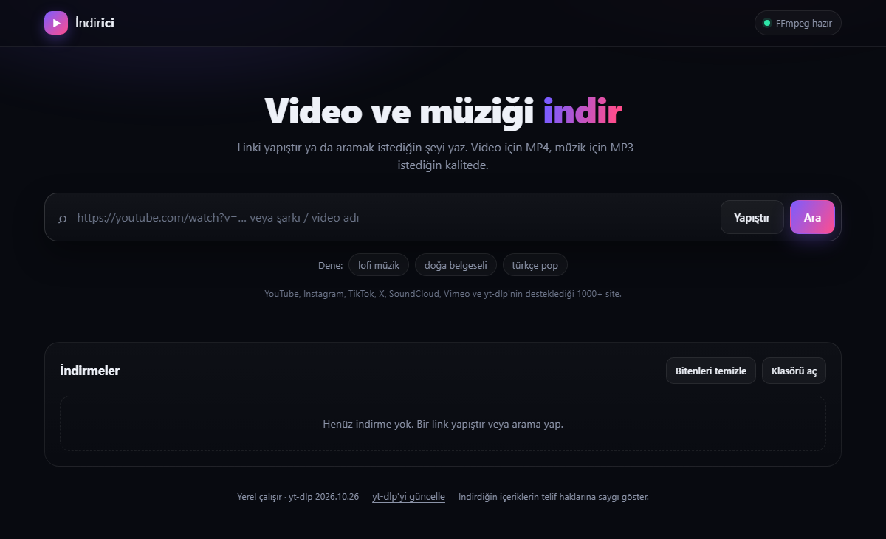

# İndirici

Windows için **masaüstü** video ve müzik indirici. Linki yapıştır ya da arama yap; videoları **MP4**, müzikleri **MP3** (ve daha fazlası) olarak istediğin kalitede indir. Tarayıcı sekmesi değil, kendi penceresinde açılan bir uygulamadır.

İndirme motoru [yt-dlp](https://github.com/yt-dlp/yt-dlp), dönüştürme için FFmpeg kullanır. Uygulama tamamen kendi bilgisayarında çalışır.



## Özellikler

- **Link yapıştır** → video bilgileri gelir, kalite ve format seçip indirirsin.
- **Arama yaz** → sonuçlar kapak görseliyle listelenir, tek tıkla indirilir.
- **Video:** MP4, MKV, WEBM — kaynağın sunduğu tüm çözünürlükler (144p'den 4K/8K'ya).
- **Ses:** MP3, M4A, OPUS, WAV, FLAC — 128 / 192 / 256 / 320 kbps veya "en iyi".
- **Oynatma listesi:** liste linkinde "tüm listeyi indir" seçeneği.
- İndirme kuyruğu, canlı ilerleme, hız / kalan süre, iptal etme.
- Dosyalar `indirilenler` klasörüne gider; tek tuşla klasör açılır.
- 1000+ site: YouTube, Instagram, TikTok, X (Twitter), SoundCloud, Vimeo, Facebook, Dailymotion…

## Kurulum (Python ile)

1. Python 3.10 veya üzeri: <https://www.python.org/downloads/>
   Kurulum ekranında **“Add python.exe to PATH”** kutusunu işaretle.
2. **`baslat.bat`** dosyasına çift tıkla.

İlk çalıştırmada paketler otomatik kurulur (birkaç dakika), ardından uygulama kendi penceresinde açılır. FFmpeg ayrıca kurmana gerek yok; `imageio-ffmpeg` ile birlikte gelir.

Windows 10/11'de **WebView2** genelde hazırdır. Değilse: <https://developer.microsoft.com/microsoft-edge/webview2/>

## EXE olarak derleme

Python kurulu bir makinede **`derle.bat`** dosyasını çalıştır:

```
dist\Indirici\Indirici.exe
```

Oluşan `dist\Indirici` klasörünün tamamını istediğin yere taşıyabilir, `Indirici.exe` için masaüstü kısayolu oluşturabilirsin. Python kurulu olmayan bilgisayarlarda da çalışır.

> Not: `derle.bat` PyInstaller kullanır ve ilk seferde internetten indirme yapar. Derleme birkaç dakika sürebilir.

## Kullanım

1. Kutucuğa video linkini yapıştır (`https://...`) ve **Getir**'e bas; ya da aramak istediğin şeyi yazıp **Ara**'ya bas.
2. Açılan pencerede **Video (MP4)** veya **Müzik (MP3)** sekmesini seç.
3. Kaliteyi ve dosya formatını seç, **İndirmeyi başlat**'a bas.
4. İlerlemeyi **İndirmeler** bölümünden takip et. Dosyalar `indirilenler` klasörüne kaydedilir.

> İpucu: `youtube.com/watch?v=...` gibi başındaki `https://` eksik linkler otomatik tamamlanır.

## Kalite ve formatlar

| Tür | Formatlar | Kalite |
|---|---|---|
| Video | MP4, MKV, WEBM | Kaynağın sunduğu tüm çözünürlükler (144p – 8K) |
| Ses | MP3, M4A, OPUS, WAV, FLAC | 128, 192, 256, 320 kbps veya en iyi |

## Proje yapısı

```
desktop.py          Masaüstü giriş noktası (pywebview penceresi)
app.py              Sunucu + indirme motoru (Flask + yt-dlp)
static/
  index.html        Arayüz
  style.css         Stiller
  app.js            Arayüz mantığı
assets/             Uygulama simgesi
docs/               Ekran görüntüsü
indirilenler/       İndirilen dosyalar (otomatik oluşur)
ayarlar.json        Ayarlar (çerez kullanımı için)
requirements.txt    Python paketleri
baslat.bat          Uygulamayı başlatır
derle.bat           Indirici.exe derler
```

Mimari: `desktop.py`, Flask sunucusunu arka planda başlatır ve arayüzü pywebview (Edge WebView2) penceresinde gösterir. Tarayıcı arayüzüyle aynı kod kullanılır; `python app.py` ile tarayıcı modunda da açılabilir.

## Sorun giderme

**Pencere açılmıyor / uygulama başlamıyor**
Proje klasöründeki `indirici-hata.log` dosyasına bak. Genelde sebep eksik paket veya WebView2'dir. `baslat.bat` paketleri kurar; WebView2 için yukarıdaki bağlantıyı kullan.

**“Sign in to confirm you're not a bot” / bot kontrolü**
YouTube bazen IP'yi doğrulama ister. `ayarlar.json` dosyasını şöyle düzenle (tarayıcın kapalı olsun):

```json
{
  "cookies_from_browser": "chrome"
}
```

`chrome` yerine `edge`, `firefox` veya `brave` yazabilirsin. Kaydettikten sonra uygulamayı kapatıp yeniden aç.

**Bir site aniden çalışmıyorsa**
Siteler sık değişir; yt-dlp'yi güncellemek genelde çözer. Python sürümünde sayfanın altındaki **“yt-dlp'yi güncelle”** düğmesini kullan, sonra uygulamayı yeniden başlat. EXE sürümünde bu düğme gizlidir; projeyi güncelleyip yeniden derle.

**“FFmpeg yok” uyarısı**
`baslat.bat` paketleri kurunca FFmpeg hazır olur. Değilse:

```bat
python -m pip install --upgrade imageio-ffmpeg
```

**İndirme yarıda kalıyor**
Uygulama penceresi kapanınca indirme durur. Pencereyi açık bırak. Aynı dosyayı tekrar başlatırsan kaldığı yerden devam eder.

**Farklı port kullanmak**

```bat
set PORT=9000
python desktop.py
```

## GitHub

Depo: <https://github.com/Zeki-wq/intro>

```bat
git clone https://github.com/Zeki-wq/intro.git
cd intro
baslat.bat
```

## Notlar

- Uygulama yalnızca `127.0.0.1` üzerinde dinler; ağdaki başka cihazlar erişemez.
- İndirme geçmişi yalnızca bellekte tutulur; uygulamayı kapatınca sıfırlanır (dosyalar kalır).
- Bu araç yalnızca **hakkına sahip olduğun** veya indirmeye izin verilen içerikler için kullanılmalıdır. İndirdiğin içeriklerin telif haklarına ve sitelerin kullanım koşullarına saygı göster.
